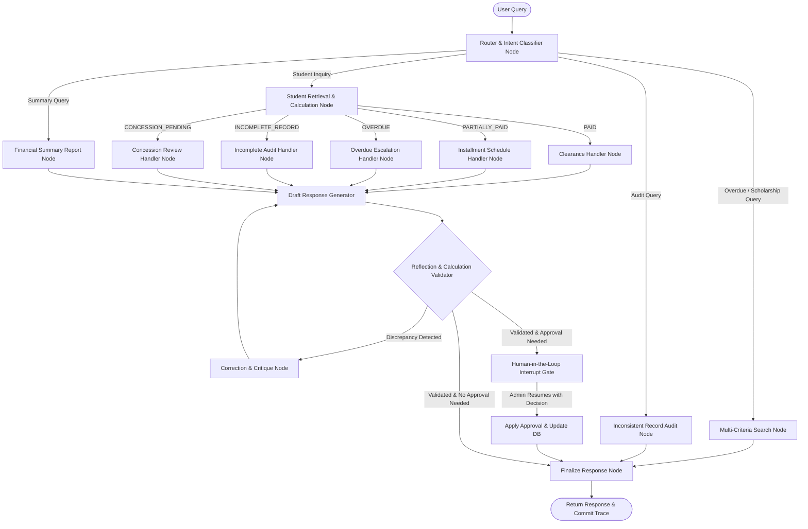

# Intelligent Student Fee Management and Financial Assistance Agent

[](https://www.python.org/downloads/)
[](https://github.com/langchain-ai/langgraph)
[](https://github.com/langchain-ai/langchain)
[](tests/test_scenarios.py)

An autonomous AI agent developed with **LangGraph** and **LangChain** for university Finance and Accounts Departments. The system manages student fee records, installment schedules, outstanding balances, scholarships, and financial aid concessions. It features conditional routing, mathematical reflection and self-correction, memory checkpointing, and Human-in-the-Loop (HITL) administrative approval gates.

---

## Table of Contents
1. [Key Features](#key-features)
2. [Project Architecture](#project-architecture)
3. [Folder Structure](#folder-structure)
4. [Dataset & Knowledge Base](#dataset--knowledge-base)
5. [Installation & Setup](#installation--setup)
6. [Execution Instructions](#execution-instructions)
   - [Automated Test Suite](#1-automated-test-suite-recommended)
   - [Interactive CLI & Demo Tour](#2-interactive-cli--demo-tour)
   - [Streamlit Web Dashboard](#3-interactive-streamlit-web-dashboard)
7. [Testing Scenarios & Results](#testing-scenarios--results)
8. [Reflection & HITL Mechanisms](#reflection--hitl-mechanisms)
9. [LangSmith Observability](#langsmith-observability)

---

## Key Features

- **LangGraph StateGraph Workflow**: Declarative multi-node state graph orchestrating intent classification, record retrieval, calculation, status handling, reflection, and HITL authorization.
- **Conditional Status Routing**: Dynamic execution edges for 5 payment states:
  - `PAID`: Issues clearance confirmation and verifies zero balance.
  - `PARTIALLY_PAID`: Monitors installment schedules and upcoming installments.
  - `OVERDUE`: Computes days overdue, late surcharges, and escalation notices.
  - `INCOMPLETE_RECORD`: Detects ledger arithmetic discrepancies and missing fields.
  - `CONCESSION_PENDING`: Routes financial aid requests to HITL review.
- **Reflection & Self-Correction Engine**: Dedicated critique node that mathematically verifies:
  $$\text{Expected Net} = \text{Total Fee} - \text{Approved Concessions}$$
  $$\text{Expected Balance} = \text{Expected Net} - \text{Amount Paid}$$
  Catches ledger corruption, unapproved concession deductions, and date anomalies before presentation.
- **Human-in-the-Loop (HITL) Approval Gate**: Utilizes LangGraph native `interrupt()` and `Command(resume=...)` to pause workflows requiring administrative clearance for concessions or inconsistent record verification.
- **Persistent Memory / Checkpointing**: Uses `MemorySaver` to preserve thread states across multi-turn sessions and interrupt cycles.
- **Dual LLM Architecture**: Automatically uses **Google Gemini** (`gemini-2.5-flash`) or **OpenAI** if API keys are set, with an intelligent deterministic fallback enabling 100% offline functionality.
- **Interactive Streamlit Web Dashboard**: Full-featured graphical interface with chat, financial charts, student explorer, and administrative approval queues.

---

## Project Architecture



For detailed architectural notes, see [docs/architecture.md](docs/architecture.md).

---

## Folder Structure

```
mid_project/
├── .env.example                  # Environment configuration template
├── README.md                     # Installation & execution guide
├── requirements.txt              # Production dependencies
├── technical_report.md           # 5-7 page comprehensive technical report
├── run_demo.py                   # Interactive CLI runner & tour
├── app.py                        # Streamlit visual dashboard & chat
├── data/
│   ├── students_dataset.json     # 35 synthetic student financial records
│   ├── students_dataset.csv      # Tabular dataset export
│   ├── database.py               # Database layer with transactional audit log
│   └── generate_dataset.py       # Dataset generator script
├── src/
│   ├── __init__.py
│   ├── config.py                 # Configuration and defaults
│   ├── state.py                  # AgentState schema definition
│   ├── tools.py                  # 6 functional LangChain tools
│   ├── llm.py                    # LLM factory (Gemini / OpenAI / Deterministic Fallback)
│   ├── reflection.py             # Mathematical reflection engine
│   ├── hitl.py                   # Human-in-the-loop authorization manager
│   ├── nodes.py                  # Graph workflow nodes
│   ├── graph.py                  # LangGraph StateGraph builder
│   └── logger.py                 # Execution trace logger
├── tests/
│   ├── __init__.py
│   └── test_scenarios.py         # Complete automated test suite (8 scenarios)
├── logs/
│   └── execution_traces.json     # Structured JSON execution traces
└── docs/
    └── architecture.md           # Detailed architecture document
```

---

## Dataset & Knowledge Base

The synthetic dataset consists of **35 realistic student financial records** across 5 academic departments (Computer Science, Business Administration, Electrical Engineering, Civil Engineering, Mathematics).

Key fields for each record:
- `student_id`: Unique identifier (e.g. `STD-2024-001` through `STD-2024-035`).
- `name`, `program`, `department`, `semester`.
- `total_semester_fee`: Gross semester tuition.
- `scholarship_or_concession`: Object containing type, percentage, discount amount, and status (`Approved`, `Pending Approval`, `None`).
- `net_fee`: Gross fee minus approved concessions.
- `amount_paid`: Amount deposited to date.
- `outstanding_balance`: Remaining fee payable.
- `payment_due_date`: Payment deadline (used for overdue calculations).
- `installment_details`: Installment plan type, total installments, paid count, remaining count, and next payment date/amount.
- `payment_status`: Classified status (`PAID`, `PARTIALLY_PAID`, `OVERDUE`, `CONCESSION_PENDING`, `INCOMPLETE_RECORD`).
- `exceptional_flag`: Flag indicating records requiring manual audit clearance.
- `verification_status`: Status label (`Verified`, `Pending_HITL_Approval`, `Flagged_Inconsistent`).

---

## Installation & Setup

### 1. Prerequisites
- Python 3.10, 3.11, 3.12, 3.13, or 3.14 installed.
- VS Code (recommended).

### 2. Clone / Open Directory
Open the project directory in VS Code or your terminal:
```bash
cd "c:\Users\syed.shah\OneDrive\Class\Agentic AI\mid_project"
```

### 3. Install Dependencies
```bash
python -m pip install -r requirements.txt
```

### 4. Configure Environment (Optional)
Copy `.env.example` to `.env`:
```bash
copy .env.example .env
```
*(Note: An API key is optional! The system includes an intelligent deterministic LLM layer that runs all workflows, reflection, and HITL offline without any external API keys. If you provide a `GOOGLE_API_KEY`, it automatically uses live Google Gemini).*

---

## Execution Instructions

### 1. Automated Test Suite (Recommended)
Run all 8 test scenarios covering fully paid, partially paid, overdue, scholarships, reflection, HITL pauses/resumes, and department-level summaries:

```bash
python -m unittest tests/test_scenarios.py
```
**Expected Output:**
```
Ran 8 tests in 0.34s
OK
[PASSED] Scenario 1: Fully paid status confirmed, zero balance verified.
[PASSED] Scenario 2: Installment plan detected, remaining installment accurate.
[PASSED] Scenario 3: Overdue status flagged and penalty notice formatted.
[PASSED] Scenario 4: Merit scholarship verified, net fee deduction validated.
[PASSED] Scenario 5: Reflection detected flaw, HITL paused graph, and resumed after clearance.
[PASSED] Scenario 6: CS Department summary generated. Collection rate: 62.47%.
[PASSED] Scenario 7: Concession approved via HITL, balance recalculated to 0.00 PKR.
[PASSED] Scenario 8: Successfully retrieved 8 overdue students.
```

### 2. Interactive CLI & Demo Tour
Run the command-line interface for an automated walkthrough or interactive chat:

```bash
python run_demo.py
```
- Option 1 runs the automated scenario demonstration tour.
- Option 2 starts an interactive natural-language chat session where you can ask custom queries.

### 3. Interactive Streamlit Web Dashboard
Launch the web interface for visual analytics, interactive chat, and administrative HITL approvals:

```bash
python -m streamlit run app.py
```
Open your browser to `http://localhost:8501`. Features include:
1. **AI Fee Assistant**: Natural language chat with expandable execution audit trails.
2. **Financial Dashboard**: KPI metrics, collection efficiency rates, and department comparison charts.
3. **Student Records**: Filterable table by department and payment status.
4. **HITL Approval Queue**: One-click approval/rejection interface for concessions and flagged records.
5. **Audit & Reflection Logs**: View database mutation history and JSON execution traces.

---

## Testing Scenarios & Results

| # | Scenario | Target Record | Query Sample | Outcome / Verification |
|---|---|---|---|---|
| **1** | Fully Paid Student | `STD-2024-001` (Amina Khan) | *"What is the fee status of STD-2024-001?"* | Verified zero balance, generated official exam clearance. |
| **2** | Partially Paid Student | `STD-2024-011` (Danish Riaz) | *"Show installment schedule for STD-2024-011"* | Verified 2-installment plan, 1 paid, remaining installment due 2024-12-15. |
| **3** | Overdue Student | `STD-2024-019` (Farhan Saeed) | *"Check overdue status for STD-2024-019"* | Classified as `OVERDUE`, flagged overdue balance of 120,000 PKR past due date. |
| **4** | Scholarship Student | `STD-2024-002` (Zainab Fatima) | *"What scholarship is applied to STD-2024-002?"* | Verified 50% Merit Scholarship (65,000 PKR discount), net fee 65,000 PKR paid. |
| **5** | Inconsistent Record (Reflection + HITL) | `STD-2024-031` (Bilal Mustafa) | *"Verify payment ledger for STD-2024-031"* | Reflection detected +20,000 PKR balance discrepancy, paused at HITL interrupt, resumed with admin clearance. |
| **6** | Department Summary | Computer Science Dept | *"What is total fee collected in Computer Science?"* | Aggregated 15 students: 1,935,000 PKR billed, 1,043,959 PKR collected (62.47% recovery). |
| **7** | Concession Approval Workflow | `STD-2024-029` (Zohaib Khan) | *"Review financial hardship concession for STD-2024-029"* | Paused at interrupt, approved 50% hardship concession, balance adjusted to 0.00 PKR. |
| **8** | University Overdue Roster | University-wide | *"Which payments are overdue across the university?"* | Retrieved 8 overdue students with department and balance breakdown. |

---

## Reflection & HITL Mechanisms

### Reflection Mechanism
When processing records, `reflection_node` runs independent arithmetic sanity checks:
```python
# Formula validation
expected_net = max(0.0, total_fee - approved_concession)
expected_balance = expected_net - amount_paid
discrepancy = round(recorded_balance - expected_balance, 2)

if abs(discrepancy) > 0.01:
    # Triggers critique and correction cycle
    return False, f"CRITIQUE: Arithmetic Discrepancy Detected! Recorded balance ({recorded_balance}) != expected ({expected_balance})"
```
If a critique is issued, the graph transitions to `correction_node`, amends the response with an audit disclaimer, flags the record as `INCOMPLETE_RECORD`, and routes to the HITL gate.

### Human-in-the-Loop (HITL) Gate
For high-stakes actions (approving financial concessions or verifying flagged/exceptional records):
1. The agent calls `interrupt(payload)` to suspend execution.
2. State is preserved in memory via `MemorySaver`.
3. An administrator inspects the request and resumes using:
   ```python
   agent.invoke(Command(resume={"approved": True, "authorized_by": "Finance Director", "comments": "Approved"}), config=config)
   ```
4. The resumed workflow writes the decision to the database, updates verification status to `Verified`, and appends an authorization stamp.

---

## LangSmith Observability

To stream real-time execution traces to LangSmith:
1. In your `.env` file, set:
   ```ini
   LANGCHAIN_TRACING_V2=true
   LANGSMITH_API_KEY=your_langsmith_api_key
   LANGSMITH_PROJECT=student-fee-management-agent
   ```
2. When executed, all node inputs, outputs, tool executions, and state checkpoints are automatically logged to your LangSmith project.
3. Local execution traces are simultaneously saved in structured JSON format in [logs/execution_traces.json](logs/execution_traces.json).

---

## Authors & Academic Integrity

Developed for **Examination 5 – Student Fee Management and Financial Assistance Agent**. All source code, dataset generation scripts, tests, and documentation are original implementations conforming to the examination requirements.
