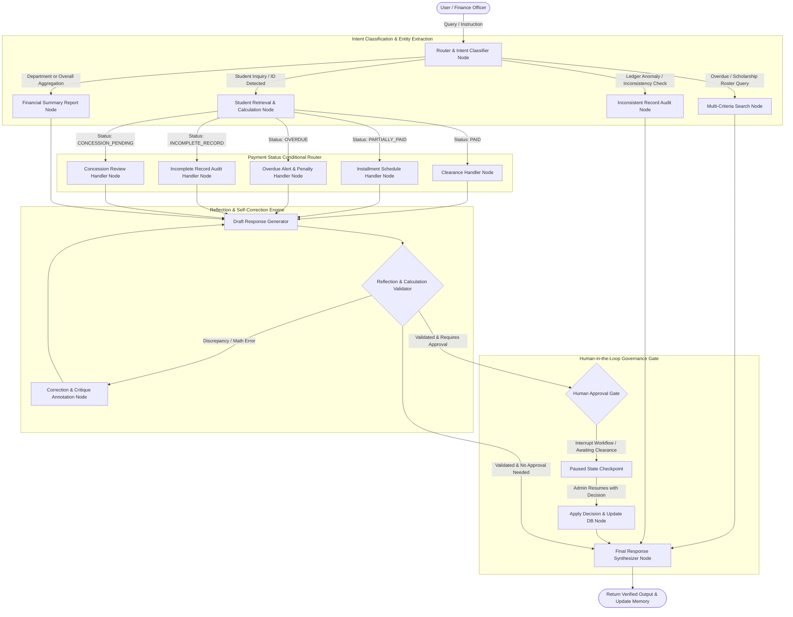

# System Architecture & Graph Flow

This document details the system design, computational graph, state schema, and decision-making flow of the **Student Fee Management and Financial Assistance Agent**.

---

## 1. High-Level Workflow Architecture

---

## 2. Component Details

### A. State Schema (`AgentState`)
- **Messages**: Conversation history (`BaseMessage` with `add_messages` reducer).
- **Query & Intent**: `query`, `query_type`, `student_id`, `department`.
- **Financial State**: `student_record`, `payment_status`, `calculation_details`, `installment_details`, `summary_report`.
- **Reflection State**: `calculation_validated` (bool), `reflection_critique` (str), `reflection_retries` (int).
- **HITL Governance State**: `requires_human_approval` (bool), `hitl_request` (dict), `hitl_decision` (dict), `verification_status` (str).
- **Output & Traceability**: `draft_response`, `final_response`, `audit_trail` (list of trace strings).

### B. Functional Tool Ecosystem
1. `retrieve_student_record`: Retrieves full record by ID from persistent storage.
2. `calculate_outstanding_balance`: Recalculates exact balance using formula:
   $$\text{Expected Balance} = \max(0, \text{Total Fee} - \text{Approved Concessions}) - \text{Amount Paid}$$
   Compares against stored ledger balance to detect arithmetic discrepancies.
3. `check_payment_status`: Classifies student into `PAID`, `PARTIALLY_PAID`, `OVERDUE`, `INCOMPLETE_RECORD`, or `CONCESSION_PENDING` factoring in audit cutoff dates.
4. `retrieve_installment_info`: Outlines installment schedule, paid installments, remaining installments, and upcoming payment amount/deadline.
5. `generate_payment_summary`: Aggregates university-wide or department-specific collections, concessions, and recovery percentages.
6. `search_students_by_criteria`: Filters students based on criteria like overdue, scholarships, outstanding balances, or ledger anomalies.

### C. Self-Correction via Reflection Engine
The reflection node acts as an automated critic:
- Checks whether `total_fee - concession == net_fee`.
- Checks whether `net_fee - amount_paid == outstanding_balance`.
- Checks if unapproved concessions were prematurely deducted.
- Checks if overdue conditions are accurately flagged.
- If any check fails, it writes a detailed critique and triggers `correction_node`.

### D. Human-in-the-Loop (HITL) Checkpointing
Using LangGraph's native `interrupt()` mechanism and `MemorySaver`:
- Any attempt to approve a concession or verify an exceptional/inconsistent ledger record pauses the graph.
- The state is persisted in memory under `thread_id`.
- An authorized officer can resume execution using `Command(resume=decision)`.
- Approved decisions are transacted into the JSON database and recorded in the audit trail.
